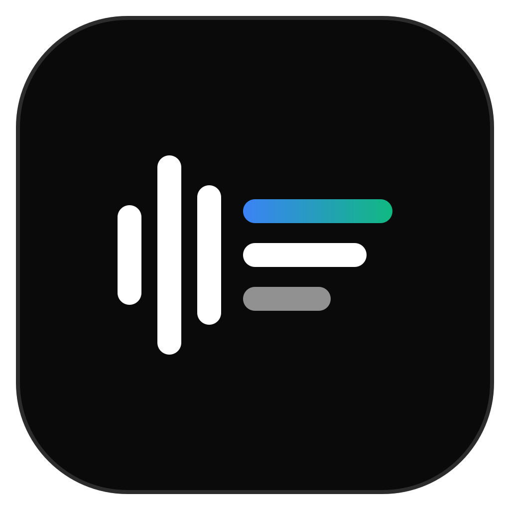

  

<h1 align="center">Renear</h1>

  <b>Rekam rapat · Transkrip otomatis · MoM siap ekspor</b>

  Aplikasi desktop Windows yang merekam rapat, mentranskrip audionya, 
  lalu menyusun notulen (MoM) atau laporan ke Word dan PDF dengan template kantor Anda.

  
  
  

  <a href="https://github.com/mwahyuk/renear-releases/releases/latest"><b>Unduh Renear untuk Windows →</b></a>

---

## Cara kerjanya

| 1. Rekam | 2. Transkrip | 3. Dokumen |
| --- | --- | --- |
| Rekam mikrofon, suara sistem (Zoom, Meet, Teams), atau keduanya. Bisa juga impor rekaman yang sudah ada. | Audio ditranskrip otomatis setiap ±10 menit selama rapat berjalan. Bahasa dikenali sendiri. | AI menyusun MoM atau laporan dari transkrip. Sunting seperlunya, lalu ekspor ke Word atau PDF. |

Di daftar rapat, tiga titik di bawah tanggal menunjukkan sampai mana setiap rapat sudah diproses, jadi terlihat sekilas mana yang masih perlu dibuatkan MoM.

## Fitur utama

- **Rekam rapat:** mikrofon, suara sistem, atau keduanya. Mic dan suara sistem bisa dibisukan sendiri-sendiri, dan gain mikrofon bisa diatur.
  - Dua rapat yang berjalan bersamaan bisa direkam terpisah, asalkan suaranya diputar ke perangkat berbeda (misalnya satu ke speaker, satu ke headset).
  - Rekaman yang sudah ada (WAV, MP3, M4A, FLAC, OGG) bisa diimpor.
- **Isi otomatis dari undangan:** impor file undangan kalender (.ics) dari email, Outlook, Zoom, atau Google Calendar; judul, waktu, platform, peserta, dan agenda langsung terisi.
- **Transkrip langsung:** progres transkripsi dan cuplikan transkrip terbaru tampil di samping perekam selama rapat berjalan.
- **Cari di semua rapat** (Ctrl+K): judul, peserta, agenda, isi transkrip, dan isi MoM/laporan, dengan kata yang cocok disorot.
- **Dokumentasi:** screenshot window rapat secara berkala, tombol **Snap** untuk screenshot kapan saja, dan foto yang diunggah sendiri.
- **MoM dan laporan:** pilih tingkat detail **Lengkap** atau **Ringkas**. Saat menyunting, preview halaman Word ikut diperbarui di sampingnya.
- **Backup dan pindah perangkat:** semua rapat, dokumen, dan pengaturan disimpan ke satu file, lalu bisa diimpor di komputer lain.
- **Sinkronisasi antar perangkat** (opsional, dengan akun Google): rapat, transkrip, dan hasil MoM/laporan sama di semua komputer Anda.
- **Tampilan bersih** dengan mode terang dan gelap, plus **update otomatis** di latar belakang.

## Cara memasang

1. Buka halaman [Releases](https://github.com/mwahyuk/renear-releases/releases/latest) dan unduh `Renear_<versi>_x64-setup.exe`.
2. Jalankan installer. Bila muncul **"Windows protected your PC"**, klik **More info → Run anyway**. Installer belum memakai sertifikat code signing.
3. Buka Renear dan mulai rekam. Transkripsi dan pembuatan MoM langsung bisa dipakai tanpa mengisi API key apa pun, dengan kuota pemakaian bulanan.

Installer memasang Renear untuk pengguna Windows yang sedang login, tanpa hak admin, dan mengunduh WebView2 bila belum ada.

### Akun (opsional)

Saat pertama dibuka, Renear menawarkan dua pilihan: **pakai di komputer ini saja**, atau **masuk dengan Google**. Login bersifat opsional, dan pilihan ini bisa diubah kapan saja di **Pengaturan → Akun**.

Dengan login, kuota pemakaian dihitung per orang dan bisa dipakai di beberapa komputer. Login saja hanya mengirim email, nama, dan foto profil Google Anda ke server Renear. Isi rapat tetap tersimpan di komputer.

### Sinkronisasi antar perangkat (opsional)

Setelah masuk dengan Google, sinkronisasi bisa diaktifkan di **Pengaturan → Akun**. Rapat lalu sama di semua komputer yang memakai akun tersebut, tanpa backup dan impor manual.

> [!IMPORTANT]
> Dengan sinkronisasi, data rapat keluar dari komputer Anda dan disimpan di server. Renear meminta persetujuan sebelum mengaktifkannya.

<b>Apa saja yang disinkronkan, dan di mana disimpan</b>

- **Yang disinkronkan:** daftar rapat (judul, waktu, peserta, agenda), transkrip, isi MoM dan laporan, gambar dokumentasi yang dicentang, dan pengaturan umum (model, bahasa, tingkat detail).
- **Yang tetap di komputer:** file audio rekaman, file Word/PDF hasil ekspor, API key, dan pilihan mikrofon/speaker.
- **API key (opsional):** dengan **Sinkronkan juga API key**, key Groq dan Gemini disimpan terenkripsi di server Renear dan terpasang otomatis di komputer lain. Server yang memegang kunci enkripsinya, jadi bila key bocor, cabut dan buat ulang di situs penyedianya. Bila dimatikan, key dihapus dari server. Transkrip dari komputer lain bisa dibaca dan disunting, tetapi tidak bisa ditranskrip ulang karena audionya tidak ikut.
- **Tempat penyimpanan:** teks disimpan di server Renear (Cloudflare). Gambar dienkripsi lalu disimpan di layanan penyimpanan file pihak ketiga.
- Bila data yang sama diubah di dua komputer, perubahan terakhir yang dipakai. Menghapus rapat juga menghapusnya di komputer lain.
- Sinkronisasi berlaku untuk semua rapat. Untuk rapat yang bersifat rahasia, jangan aktifkan sinkronisasi.
- Sinkronisasi bisa dihentikan kapan saja, dan **Hapus data saya di server** menghapus seluruh salinan di server.

### Memakai API key sendiri (opsional)

Kalau ingin memakai akun AI sendiri, buka **Pengaturan → AI & API**, aktifkan **Pakai API key sendiri**, lalu tambahkan key:

- **Groq** (transkripsi): gratis di console.groq.com.
- **Google Gemini** (MoM dan laporan): gratis di aistudio.google.com.

Tombol **Dapatkan key** di Renear langsung membuka halaman pembuatannya. Dengan key sendiri, pemakaian mengikuti batas akun Anda.

### Ekspor PDF

Ekspor PDF memakai **Microsoft Word**, **LibreOffice**, atau **GenOffice**, mana pun yang terpasang. Ekspor Word bisa dipakai tanpa ketiganya.

### Mengisi rapat dari undangan kalender (.ics)

Di halaman **Buat meeting**, klik **Impor undangan (.ics)** lalu pilih file undangannya. Judul, waktu, platform, tempat, peserta, dan agenda terisi otomatis; periksa lalu simpan. Tautan rapat, ID, dan kode sandi tidak ikut disalin, dan file hanya dibaca di komputer Anda. Rapat berulang diisi dengan jadwal pertamanya.

<b>Cara mendapatkan file .ics</b>

- **Email undangan** (Gmail, Yahoo, email kantor): buka email undangan, cari lampiran `invite.ics` di bagian bawah, lalu unduh.
- **Outlook desktop:** buka rapat di Kalender → **File → Simpan Sebagai** → pada *Save as type* pilih **iCalendar Format (\*.ics)**. Cara cepat: seret rapat dari kalender ke Desktop. Undangan Microsoft Teams juga bisa diambil dengan cara ini.
- **Zoom:** masuk ke zoom.us → **Meetings** → klik judul rapat → **Outlook Calendar (.ics)**.
- **Google Calendar:** untuk undangan dari orang lain, unduh lampiran `invite.ics` dari email undangannya. Untuk acara buatan sendiri: **Setelan → Impor & ekspor → Ekspor**, ekstrak file .zip, lalu pilih file .ics kalender Anda; Renear menampilkan daftar acaranya untuk dipilih.

## Update

Renear mengecek versi baru saat dibuka dan beberapa kali sehari. Versi baru diunduh di latar belakang dan dipasang saat Renear ditutup, tidak saat rekaman berjalan. Pengaturannya ada di **Pengaturan → Aplikasi**.

## Data dan privasi

- Rekaman, transkrip, dokumen, dan pengaturan tersimpan di komputer Anda (`%APPDATA%\com.renear.app`). API key disimpan di Windows Credential Manager.
- Bila sinkronisasi diaktifkan, salinan rapat (tanpa audio dan file Word/PDF) disimpan di server Renear seperti dijelaskan di atas.
- Untuk transkripsi dan pembuatan dokumen, audio dan teks rapat dikirim ke layanan AI pihak ketiga (Groq, Google Gemini, Agnes AI), baik lewat layanan Renear maupun langsung bila memakai key sendiri. Isi rapat tidak disimpan oleh layanan Renear.
- Untuk rapat yang bersifat rahasia, sebaiknya tidak memakai fitur AI.

## Riwayat perubahan

Catatan setiap versi ada di halaman [Releases](https://github.com/mwahyuk/renear-releases/releases). Di dalam aplikasi, riwayat versi bisa dibuka di **Pengaturan → Aplikasi**.

---

  Repo ini hanya berisi file rilis; kode sumber Renear tidak dipublikasikan.

